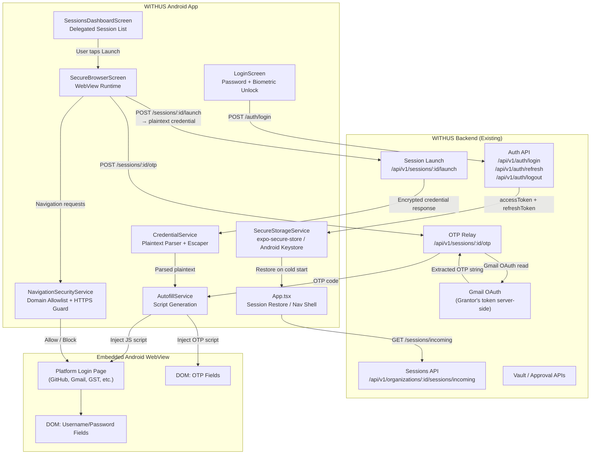

# WITHUS Android Mobile Secure Browser PoC
## Technical Audit and Gap Register

**Version:** 1.0  
**Audit Date:** 21 November 2026  
**Branch:** `feat/withus-mobile-secure-browser-poc`  
**Commit at audit:** `a02c61de23f57450e30b5322fd84f99b641acfc1` (uncommitted working-tree changes also inspected)  
**Device tested:** Realme RMX3998, Android 14, `QSZ5I7RWHYHAWCU4`  
**APK inspected:** `app-debug.apk` (142.8 MB, built from working tree)  
**Auditors:** Gravity (AI, first pass) + Second-pass challenge review  
**Status:** Permanent technical record. Do not treat as a marketing document.

---

> [!IMPORTANT]
> This document is the single authoritative technical record for the WITHUS Mobile PoC. All findings supersede earlier standalone audit reports. Where a previous finding has been corrected, the correction is recorded here with the original claim and the corrected verdict.

---

## A. Executive Summary

### What This Application Is

The WITHUS Mobile Secure Browser is an Android application built on React Native / Expo. It extends WITHUS delegated-access functionality to Android by embedding an Android WebView and connecting to the existing WITHUS backend API.

The primary motivation is that Chrome extensions, which provide credential autofill and OTP relay on desktop, are not supported in standard Android Chrome. The mobile application fills this gap with a dedicated native application.

### What It Successfully Demonstrates (Verified)

- WITHUS account authentication and token persistence on Android via Expo Secure Store / Android Keystore
- Organization selection and delegated-session dashboard rendering
- Platform-specific secure WebView launch from a delegated session
- Top-frame navigation allowlisting for 11 configured platforms
- User-initiated credential autofill (username, password, combined, multi-step) via DOM injection
- Backend Gmail OTP retrieval and injection into WebView OTP fields
- Gmail session tested on physical device to the Google 2FA "Check your phone" prompt
- Native biometric unlock at the login screen
- Navigation drawer with 9 application modules
- Android secure storage using expo-secure-store backed by Android Keystore

### What It Does Not Yet Demonstrate (Gaps)

- Complete authenticated login on any platform (no inbox, dashboard, or post-login page shown on device)
- Cookie isolation between successive delegated sessions
- Immediate WebView termination following backend revocation
- Screenshot protection (FLAG_SECURE is explicitly disabled)
- Biometric re-authentication on app resume or sensitive actions beyond initial login
- Live E2E testing for 10 of 11 platforms on a physical device

### Overall Security Posture

The application has meaningful security controls but several gaps that must be addressed before pilot use. The current implementation is best described as:

> An Android-based delegated-access browser PoC with user-guided credential autofill, backend OTP relay, and platform-specific navigation controls. It is not a production-equivalent secure browsing environment.

### Suitability Assessment

| Use Case | Suitable? | Conditions |
|---|---|---|
| Internal development and testing | ✅ Yes | As-is |
| Supervised client demonstration | ✅ Yes | With security limitations disclosed |
| External device handover to client | ⚠️ Caution | Only if device stays under WITHUS control; debug APK should not leave supervised setting |
| Limited pilot (employee fleet) | ❌ Not yet | Requires P0 remediation items |
| Production | ❌ Not yet | Requires P0 + P1 remediation |

### Most Important Outstanding Issues

1. **Cookie persistence** — WebView cookies persist across session closures; Session B can inherit Session A's authenticated website state
2. **FLAG_SECURE disabled** — Screenshot and app-switcher capture protection is explicitly cleared
3. **Biometric enforcement gaps** — Cold-start restore and sensitive actions have no biometric gate
4. **Active WebView revocation** — Backend revocation does not terminate an already-open WebView
5. **Release signing not configured** — Even the `release` build variant uses the debug keystore

---

## B. System Architecture

### B.1 Technology Stack

| Layer | Technology | Version |
|---|---|---|
| Framework | React Native + Expo | RN 0.88.1, Expo ~58.0.26 |
| Language | TypeScript | ~6.0.3 |
| React | React | 19.3.0 |
| WebView | react-native-webview | 14.0.1 |
| Biometrics | expo-local-authentication | ~58.0.3 |
| Secure Storage | expo-secure-store | ~58.0.3 |
| Native Android | Kotlin | — |
| Build System | Gradle + React Native Gradle Plugin | Gradle 9.4.1 |
| JS Engine | Hermes | — |

**Source:** `apps/mobile/package.json`

### B.2 Application Modules

| Module | Screen File | Status |
|---|---|---|
| Login + Biometric Unlock | `LoginScreen.tsx` | Implemented |
| Navigation Drawer | `NavigationDrawer.tsx` | Implemented |
| Bottom Navigation Bar | `BottomNavBar.tsx` | Implemented |
| Dashboard Overview | `DashboardOverviewScreen.tsx` | Implemented (API-integrated) |
| Vaults | `VaultsScreen.tsx` | Implemented (API-integrated) |
| Sessions Dashboard | `SessionsDashboardScreen.tsx` | Implemented (API-integrated) |
| Secure Browser | `SecureBrowserScreen.tsx` | Implemented (core feature) |
| Activity / Presence | `ActivityScreen.tsx` | Implemented (API-integrated) |
| Approvals | `ApprovalsScreen.tsx` | Implemented (API-integrated) |
| Audit Log | `AuditLogScreen.tsx` | Implemented (API-integrated) |
| Integrations | `IntegrationsScreen.tsx` | Implemented (API-integrated) |
| Team | `TeamScreen.tsx` | Implemented (API-integrated) |
| Settings | `SettingsScreen.tsx` | Implemented (API-integrated) |

### B.3 Services

| Service | File | Responsibility |
|---|---|---|
| ApiService | `api.service.ts` | All backend HTTP calls; refresh token mutex |
| SecureStorageService | `storage.service.ts` | Keystore read/write for tokens and profile |
| BiometricsService | `biometrics.service.ts` | Local biometric authentication |
| NavigationSecurityService | `security.service.ts` | Domain allowlist; HTTPS enforcement |
| AutofillService | `autofill.service.ts` | Credential and OTP script generation |
| CredentialService | `credential.service.ts` | Plaintext parsing; script-safe escaping |

### B.4 Architecture Diagram



### B.5 Credential and OTP Data Flow (Detailed)

**Credential Flow:**

```
Grantor sets credentials on WITHUS Web
         ↓
Backend stores encrypted credential (vault)
         ↓
Delegated user opens mobile app → Session authenticated via JWT
         ↓
User taps "Fill Credentials" in SecureBrowserScreen
         ↓
ApiService.launchSession() → POST /api/v1/sessions/:id/launch
         ↓
Backend validates session authorization → returns plaintext credential in response body
         ↓
CredentialService.parsePlaintext() → { username, password } object on JS heap (Copy 1, 2)
         ↓
cachedCredentialsRef.current = credentials (Copy 3 — persists until close/background)
         ↓
AutofillService.buildAutofillScript() → JS string with embedded credentials (Copy 4, 5)
         ↓
webViewRef.current.injectJavaScript(script) → WebView JS context (Copy 6)
         ↓
var u = "username"; var p = "password"; → el.value = u / el.value = p (Copy 7 in DOM)
         ↓
u = null; p = null; inside injected script (logical clear — GC controls physical erasure)
         ↓
DOM el.value remains readable by page JavaScript until page navigates away
```

**OTP Flow:**

```
User taps "Fetch OTP" in SecureBrowserScreen
         ↓
ApiService.fetchSessionOtp() → POST /api/v1/sessions/:id/otp
         ↓
Backend reads grantor's Gmail via stored OAuth token (token never sent to mobile)
         ↓
Backend extracts OTP string from email → returns OTP code in response body
         ↓
AutofillService.buildOtpFillScript() → JS string with embedded OTP (copy on heap)
         ↓
webViewRef.current.injectJavaScript(script) → WebView injects OTP into fields
         ↓
Inside script: code = null (logical clear only)
```

**Secure Storage Keys** (`storage.service.ts`):

| Key | Content | Persistence |
|---|---|---|
| `withus_access_token` | JWT access token | Until logout or clearAllAuthData() |
| `withus_refresh_token` | Refresh token | Until logout or clearAllAuthData() |
| `withus_user_profile` | User JSON (no password) | Until logout |
| `withus_organization` | Active org JSON | Until logout |
| `withus_all_organizations` | All orgs JSON | Until logout |
| `withus_api_base_url` | Backend URL | Persistent |
| `withus_biometric_enabled` | Boolean string | Persistent |

All keys stored with `expo-secure-store` using `AFTER_FIRST_UNLOCK` accessibility.  
Credentials (username/password) are **never stored** in Secure Store — they are fetched on demand per session action.

---

## C. Complete Findings Register

| ID | Category | Finding | Severity | Status | Evidence | Required Action | Target |
|---|---|---|---|---|---|---|---|
| F-01 | Session Isolation | WebView cookies not cleared on session close | Critical | Open | `SecureBrowserScreen.tsx:437` `handleClose()` calls only `cachedCredentialsRef.current = null`; no `CookieManager.removeAllCookies()`; `sharedCookiesEnabled={true}` confirmed at WebView props | Add `CookieManager.removeAllCookies()` with async callback + `WebStorage.deleteAllData()` before `onClose()` | P0 |
| F-02 | Session Isolation | Session B can inherit Session A's platform auth cookies | Critical | Open | `thirdPartyCookiesEnabled={true}`, `sharedCookiesEnabled={true}`, persistent `CookieManager` jar; `incognito` prop removed to fix GST portal loading | Implement cookie clearing and test cross-session isolation | P0 |
| F-03 | Security | FLAG_SECURE explicitly cleared — screenshots and app-switcher capture unprotected | Critical | Open | `MainActivity.kt:23`: `window.clearFlags(WindowManager.LayoutParams.FLAG_SECURE)`; comment states "allow screen recording and client demo capture" | Restore `FLAG_SECURE`; add conditional for demo mode if required | P0 |
| F-04 | Security | Backend revocation does not terminate active WebView | High | Open | Zero `WebSocket`, `EventSource`, or `setInterval` in `SecureBrowserScreen.tsx`; revocation only blocks future `/launch` and `/otp` API calls; open WebView and existing platform session continue | Implement poll or SSE subscription for session revocation signal; force close WebView on signal | P0 |
| F-05 | Security | Biometrics not enforced on cold-start session restore | High | Open | `App.tsx:74`: `restoreSessionFromKeystore()` restores full session using stored refresh token with no biometric gate | Add biometric challenge before completing cold-start restore when biometrics available and enrolled | P0 |
| F-06 | Security | No biometric gate on session launch, credential fill, or OTP retrieval | High | Open | `SecureBrowserScreen.tsx`: `handleFillCredentials()` and `handleFetchAndFillOtp()` call API directly with no biometric challenge | Add opt-in (or mandatory) biometric confirmation before credential reveal and OTP fetch | P0 |
| F-07 | Credential Exposure | Plaintext credentials exist in multiple JS heap copies during autofill | Medium | Open (architectural) | `api.service.ts` response body → `CredentialService.parsePlaintext()` return → `cachedCredentialsRef.current` → script string → WebView context — 7+ copies tracked | Cannot eliminate DOM injection by design; document as architectural limitation; ensure heap copies are minimized and refs cleared promptly | P1 |
| F-08 | Credential Exposure | Destination website JavaScript can read injected form values | Medium | Open (architectural) | `el.value = u` in injected script; any page-side script can read `document.querySelector(...).value` before or after injection | Cannot eliminate without changing autofill approach; disclose as inherent limitation; `u = null` after fill provides partial mitigation | P1 |
| F-09 | Credential Exposure | Background DOM clearing sets visible field values to empty string — physical memory erasure not guaranteed | Low | Open (architectural) | `SecureBrowserScreen.tsx:120-150`: `clearDomScript` injects `nativeSetter.set.call(el, '')` on backgrounding; GC controls actual memory | Document as inherent JS memory limitation; not fixable at application level | Acknowledged |
| F-10 | WebView Security | Subframe navigation (iframes) is unrestricted — allowlist applies to top-frame only | Medium | Open | `SecureBrowserScreen.tsx:174`: `if (request.isTopFrame === false) return true;` — all iframe/subframe requests bypass allowlist | Evaluate subframe CSP restrictions; document as architectural tradeoff for platform compatibility | P1 |
| F-11 | Compatibility | Google embedded WebView restriction — Gmail 2FA "Check your phone" cannot be completed in WebView | High | Open | Google detects WebView user agent and blocks device-push 2FA flows; physically observed on Realme RMX3998 | Add app-switching guidance to user; evaluate Google OAuth native flow; this may not be fully solvable within WebView | P0 (documentation/UX) |
| F-12 | Compatibility | CAPTCHA and manual verification on GST, MCA, Udyam portals | High | Open | Physical device testing showed GST portal loads but login requires manual CAPTCHA | Document as known limitation; provide manual CAPTCHA workflow guidance | P0 (documentation) |
| F-13 | Compatibility | OTP support limited to Gmail email relay — no SMS, WhatsApp, or TOTP | Medium | Open | `api.service.ts` OTP endpoint only connects to Gmail OAuth backend; no alternative OTP source | Scope SMS/TOTP as future work if required by client | P2 |
| F-14 | Compatibility | Platform autofill selectors may break if target websites change their DOM | Medium | Open | Selectors in `autofill.service.ts` are static CSS strings; e.g. GitHub: `input[name="login"]`; Gmail: `input[type="email"]` | Implement selector update process and regression alerts | P1 |
| F-15 | Testing | Live E2E platform testing incomplete — only Gmail autofill to 2FA prompt confirmed on physical device | High | Open | Physical device evidence: password filled, Google 2FA prompt shown; no inbox/dashboard screenshot for any platform | Conduct live device testing for all 11 platforms; document pass/fail per platform | P0 |
| F-16 | Logging | Autofill console log at `SecureBrowserScreen.tsx:367` — operational metadata only | Low | Open | `console.log('[AUTOFILL_RESULT]', JSON.stringify(payload))` logs `{success, step, usernameFilled, passwordFilled, uTag, pTag, error}` — no credential values | Guard with `__DEV__` or remove before pilot | P1 |
| F-17 | Build / Release | Current APK is debug-signed with `CN=Android Debug` certificate | High | Open | `apksigner verify --print-certs` → `CN=Android Debug`; `application-debuggable` flag confirmed in `aapt badging` | Provision production keystore; configure `release` signing config in `build.gradle` | P0 (before pilot) |
| F-18 | Build / Release | Release build variant explicitly uses debug keystore (`signingConfigs.debug` assigned to release block) | High | Open | `build.gradle` release block: `signingConfig signingConfigs.debug`; no `release` signingConfig defined | Add production signing config; never assign `signingConfigs.debug` to `release` | P0 (before pilot) |
| F-19 | Build / Release | Debug APK has `android:debuggable=true` → WebView JS debugging accessible via USB | Medium | Open | Merged manifest and packaged manifest both confirm `android:debuggable="true"`; `react-native-webview` auto-enables `setWebContentsDebuggingEnabled(true)` when debuggable | Physical Chrome DevTools verification NOT VERIFIED (no device connected at audit time); release variant will have `debuggable=false` per AGP default | P0 (pilot) |
| F-20 | Build / Release | Minification disabled in debug build; enabled for release via `gradle.properties` | Low — Informational | Correctly configured | `gradle.properties:32`: `android.enableMinifyInReleaseBuilds=true`; debug build has no minification | No action for release; ensure ProGuard rules tested in release build | P1 (validate release) |
| F-21 | Build / Release | Production signing keystore not provisioned | High | Open | No `release` signing config in `build.gradle`; no `.jks` or `.keystore` file found in project | Generate and securely store production keystore before pilot | P0 (before pilot) |
| F-22 | Android Security | Android backup exclusion rules present in APK — backup exposure claim CORRECTED | — | Closed (corrected) | `aapt list app-debug.apk` shows `res/xml/secure_store_backup_rules.xml` and `res/xml/secure_store_data_extraction_rules.xml` present; both exclude `path="SecureStore"` from cloud backup and device transfer; Keystore keys are device-bound | **Previous finding was incorrect.** No action required. Monitor on expo-secure-store version upgrades. | Closed |
| F-23 | Security | Biometric fallback allows device PIN/password — `disableDeviceFallback: false` | Low | Open | `biometrics.service.ts:52`: `disableDeviceFallback: false` and `fallbackLabel: 'Use Password'` | Acceptable for PoC; evaluate whether PIN fallback weakens biometric security requirement for pilot | P1 |
| F-24 | Security | No `setWebContentsDebuggingEnabled` call in native code — library controls it via debuggable flag | Informational | Acknowledged | `MainActivity.kt` and `MainApplication.kt` contain no explicit `setWebContentsDebuggingEnabled`; `react-native-webview` calls it automatically when `android:debuggable=true` | Will be resolved by producing release APK with `debuggable=false` | Resolved by F-17/F-18 |
| F-25 | Architecture | `cachedCredentialsRef.current = null` does not guarantee physical memory erasure | Low | Open (architectural) | JavaScript null assignment removes object reference; Hermes GC controls actual memory reclamation; timing is non-deterministic | Document as inherent JS limitation; cannot be fixed at application level without native bridge | Acknowledged |
| F-26 | Compatibility | Gmail allowlist requires broad Google domain permissions including `*.youtube.com` for SetSID auth sync | Low | Open | `security.service.ts:117-121` and `220-221`: `accounts.youtube.com`, `youtube.com`, `*.youtube.com` added to Gmail allowedDomains due to Google cross-domain auth redirect | Accepted tradeoff; document as expected Google auth behavior | Acknowledged |
| F-27 | Architecture | Single active session enforced at UI level only — not at authentication context level | Medium | Open | `App.tsx`: `activeSession` state allows one WebView at a time; but persistent cookies mean different "sessions" may share platform auth state | Cookie clearing (F-01) partially addresses this; document remaining limitation | P0 (tied to F-01) |
| F-28 | Build / Release | `EX_DEV_CLIENT_NETWORK_INSPECTOR=true` in `gradle.properties` | Low | Open | Network inspector enabled in development; should be disabled or confirmed not included in release builds | Verify release build excludes network inspector | P1 |
| F-29 | Architecture | App resume from background does not re-authenticate user | Medium | Open | `AppState 'active'` handler in `SecureBrowserScreen.tsx` only sets `setIsAppInBackground(false)`; no biometric re-challenge | Add configurable biometric re-auth on resume from background | P0 |

---

## D. Android Security Audit

### D.1 Cookie Persistence and Session Isolation (F-01, F-02)

**What the problem is:**  
When a delegated session closes, the app calls `cachedCredentialsRef.current = null` and `onClose()`. No WebView cookie clearing occurs.

**How it occurs:**  
`react-native-webview` with `sharedCookiesEnabled={true}` and `thirdPartyCookiesEnabled={true}` stores cookies in Android's `CookieManager`, which persists across WebView instances. The `incognito` prop was removed to fix GST portal bot-detection, leaving cookie persistence as the only viable mode.

**Realistic impact:**  
Employee A authenticates Gmail. Session closes. Employee B opens a Gmail session on the same device. The WebView loads Gmail and finds Employee A's authentication cookies — Gmail may auto-authenticate without requiring login.

**Physical access required:** Yes — same device, different users. Not a remote attack.

**Existing mitigation:** None currently.

**Missing protection:** `CookieManager.removeAllCookies(callback)` and `WebStorage.getInstance().deleteAllData()` on session close.

**Remediation:**
```kotlin
// Android native or via RN bridge:
CookieManager.getInstance().removeAllCookies { success ->
    WebStorage.getInstance().deleteAllData()
    // then call onClose()
}
```

**Regression risk:** Medium — clearing cookies affects all in-flight requests at the moment of closing. Callback completion must be awaited.

---

### D.2 FLAG_SECURE Disabled (F-03)

**What the problem is:**  
Android `FLAG_SECURE` prevents the system from capturing the window in screenshots, screen recordings, and the recent-apps (app-switcher) thumbnail. It is explicitly cleared.

**How it occurs:**  
`MainActivity.kt:23`: `window.clearFlags(WindowManager.LayoutParams.FLAG_SECURE)`. The comment confirms it was intentionally cleared for demo capture.

**Realistic impact:**  
Any user or attacker with device access can screenshot the screen while credentials are displayed or autofilled. The app-switcher preview may show the WebView content including partial credential forms.

**Physical access required:** Yes — device must be in hand.

**Limitations of FLAG_SECURE:**  
FLAG_SECURE prevents system-level screenshot capture and app-switcher thumbnails. It does not prevent an external camera photographing the screen. It is not an absolute protection against all recording methods.

**Remediation:** Remove the `clearFlags` call before pilot. If demo capture is required, make it configurable via a build flag.

---

### D.3 Biometric Enforcement Gaps (F-05, F-06, F-23, F-29)

**What the problem is:**  
Biometric authentication exists at the login screen but is not enforced at other sensitive points.

**Current biometric gates:**
- Login screen: Optional "Unlock with Biometrics" button — user-initiated only

**Missing biometric gates:**
- Cold-start restore (`App.tsx:74` `restoreSessionFromKeystore`) — restores full authenticated state from stored refresh token with no biometric challenge
- App resume from background — `setIsAppInBackground(false)` only; no re-authentication
- Session launch — tapping "Launch Secure Browser" directly opens the WebView
- Credential reveal — tapping "Fill Credentials" calls the API without biometric challenge
- OTP retrieval — no biometric gate

**Realistic impact:**  
If a device is unlocked (or the attacker knows the device PIN), they can open the WITHUS app, navigate to any delegated session, launch the WebView, and trigger credential autofill — all without biometric re-authentication.

**Fallback risk:**  
`disableDeviceFallback: false` allows device PIN/password as a biometric fallback. This is acceptable if the security requirement is "biometric or device PIN", but should be explicitly documented.

---

### D.4 Remote Revocation Does Not Terminate Active WebView (F-04)

**What the problem is:**  
The backend can revoke a delegated session, preventing future credential and OTP retrieval. However, an already-open WebView is not notified or terminated.

**How it occurs:**  
No `WebSocket`, `EventSource`, or polling mechanism exists in `SecureBrowserScreen.tsx`. The mobile app learns of revocation only on its next API call that fails with 403.

**Realistic impact:**  
An administrator revokes a session while a delegate is using the WebView. The delegate continues to have full access to the platform in the WebView for the duration of the platform's existing cookie/session. This may be minutes to hours depending on the platform's session timeout.

**What revocation does block:**  
Future `POST /sessions/:id/launch` → 403  
Future `POST /sessions/:id/otp` → 403  
Future session listing → session removed from dashboard

**What revocation does NOT block:**  
Active WebView; established platform authentication via cookies.

**Recommended remediation:**  
Implement a polling mechanism (e.g. every 30 seconds) or SSE subscription that checks session validity. On revocation signal: `webViewRef.current?.stopLoading()`, navigate WebView to `about:blank`, and call `handleClose()`.

---

### D.5 Debug APK WebView Debugging (F-19)

**What the problem is:**  
`android:debuggable=true` causes `react-native-webview` to call `WebView.setWebContentsDebuggingEnabled(true)`. Chrome DevTools can attach to the WebView on a physically connected PC via `chrome://inspect`.

**Physical access required:** Yes — USB cable + ADB authorization (device trust prompt required).

**Remote exploitation:** No — ADB requires physical USB connection. Wireless ADB requires explicit device-side enablement.

**Practical risk in supervised demo:** Low — the demo presenter controls the device. No untrusted USB connections occur in a supervised setting.

**Practical risk if device is handed to client:** Medium — anyone with a USB cable and laptop can inspect WebView DOM during autofill operations.

**The specific window of risk:** Chrome DevTools must be attached while the WITHUS app is foregrounded and actively performing the 2–3 second autofill injection. This is a narrow but real window.

**Resolved by:** Producing a release APK with `android:debuggable=false`.

---

## E. Credential and OTP Data Flow

### E.1 All Plaintext Credential Copies During Autofill

| Copy | Location | Cleared by | Guarantee |
|---|---|---|---|
| 1 | `fetch()` response body in `ApiService.launchSession()` | JS GC after function returns | No — GC timing |
| 2 | `CredentialService.parsePlaintext()` return value | JS GC | No |
| 3 | `cachedCredentialsRef.current` | `= null` on close/background | Logical only — GC controls physical |
| 4 | Function arguments to `buildAutofillScript()` | JS GC | No |
| 5 | Injected JS script string (contains credentials inline) | JS GC after injection | No |
| 6 | WebView JavaScript context (`var u`, `var p`) | `u = null; p = null` inside script | Logical only — WebView process memory |
| 7 | DOM `el.value` | Background clear script sets `el.value = ''` | No — page JS may have cached it |

**None of these copies can be guaranteed to be physically erased from memory.** JavaScript and the WebView process do not expose memory zeroing APIs at the application level.

**What is not stored:** No copy of username or password is ever written to Expo Secure Store, AsyncStorage, SQLite, or any persistent storage.

---

## F. Platform Compatibility Matrix

### Evidence classification key
- ✅ **Source-verified** — Selector or config confirmed in source code
- 🧪 **Mock-tested** — Node.js mock-DOM test passed (not a real browser)
- 📱 **Device-tested** — Run on physical Realme RMX3998, Android 14
- 🔐 **E2E verified** — Complete login with authenticated session confirmed on device
- ❌ **Not tested** — No evidence of real-device or live testing

| Platform | Config | Autofill Selectors | Mock Tests | Physical Device | Full E2E | Known Issues |
|---|---|---|---|---|---|---|
| **Gmail** | ✅ | ✅ | 🧪 | 📱 (to 2FA prompt only) | ❌ | Google 2FA "Check your phone" prompt shown but cannot be completed in WebView; broad domain allowlist required for SetSID auth sync |
| **GitHub** | ✅ | ✅ | 🧪 | ❌ | ❌ | Selector: `input[name="login"]`, `input[name="password"]` — not live-tested |
| **Vercel** | ✅ | ✅ | 🧪 | ❌ | ❌ | Selector: `input[type="email"]`, `input[type="password"]` — not live-tested |
| **GoDaddy** | ✅ | ✅ | 🧪 | ❌ | ❌ | Multi-step (email → password); `sso.godaddy.com` in allowedDomains |
| **LinkedIn** | ✅ | ✅ | 🧪 | ❌ | ❌ | Standard form selectors |
| **Shopify** | ✅ | ✅ | 🧪 | ❌ | ❌ | Multi-step; `accounts.shopify.com`, `admin.shopify.com` allowed |
| **Stripe** | ✅ | ✅ | 🧪 | ❌ | ❌ | Selector includes `id="old-password"` variant |
| **Razorpay** | ✅ | ✅ | 🧪 | ❌ | ❌ | Phone/email field (`input[type="tel"]`) included |
| **MCA** | ✅ | ✅ | 🧪 | 📱 (page loaded) | ❌ | Manual CAPTCHA required; bot detection present |
| **GST** | ✅ | ✅ | 🧪 | 📱 (page loaded) | ❌ | Manual CAPTCHA required; `incognito` prop removal was needed for cookie-based session support |
| **Udyam** | ✅ | ✅ | 🧪 | ❌ | ❌ | Government portal; CAPTCHA likely; not device-tested |

### Platform Compatibility Notes

**Google OAuth Restriction (all platforms with Google login):**  
Google's authentication systems detect Android WebView user agents and may refuse to show the full OAuth consent screen or redirect to an unsupported flow. This affects Gmail directly and may affect any platform using "Sign in with Google."

**CAPTCHA Limitation:**  
GST, MCA, and Udyam use image CAPTCHAs that require manual user interaction. WITHUS cannot automate CAPTCHA solving. The user must solve the CAPTCHA themselves before autofill can proceed.

**Selector Fragility:**  
All CSS selectors in `autofill.service.ts` are static strings. Any website DOM change (class rename, ID change, structural restructure) can silently break autofill for that platform without warning.

---

## G. Android Build and Release Readiness

### G.1 Current Debug APK (`app-debug.apk`)

| Property | Value | Evidence |
|---|---|---|
| Package name | `com.withus.securebrowser` | `aapt badging` |
| Version code | 1 | `aapt badging` |
| Version name | 1.0.0 | `aapt badging` |
| `android:debuggable` | `true` | Packaged manifest; `aapt badging` shows `application-debuggable` |
| Signing certificate DN | `CN=Android Debug, OU=Android, O=Unknown` | `apksigner verify --print-certs` |
| Certificate SHA-256 | `fac61745dc0903786fb9ede62a962b399f7348f0bb6f899b8332667591033b9c` | `apksigner` |
| WebView JS debugging | Expected active (library auto-enables when `debuggable=true`) | Source inference; physical verification NOT PERFORMED |
| Minification | Disabled | Debug build type; `gradle.properties` only enables for release |
| minSdkVersion | 24 (Android 7.0) | `aapt badging` |
| targetSdkVersion | 36 | `aapt badging` |
| compileSdkVersion | 37 | `aapt badging` |
| APK size | 142.8 MB | File system |

### G.2 Release Variant (Source-Inferred — No Release APK Built)

| Property | Value | Basis |
|---|---|---|
| `android:debuggable` | `false` (expected) | AGP default for release build type; not overridden in `build.gradle` | 
| Signing certificate | `CN=Android Debug` (same as debug) | `build.gradle` release block: `signingConfig signingConfigs.debug` explicitly assigned |
| WebView JS debugging | Inactive (expected) | Library uses `debuggable` flag; release will have `debuggable=false` |
| Minification | **Enabled** | `gradle.properties:32`: `android.enableMinifyInReleaseBuilds=true` |
| Resource shrinking | Disabled | No `enableShrinkResourcesInReleaseBuilds` property set |
| ProGuard | Loaded but only active when minify enabled | `proguardFiles` configured; will run in release |

> [!CAUTION]
> The release variant signing gap is critical. `build.gradle` explicitly assigns `signingConfig signingConfigs.debug` to the `release` block. A release APK from this project is signed with the debug certificate. No production keystore exists.

### G.3 Android Backup (Corrected Finding)

**Previous claim:** Backup XML files missing; tokens could be backed up to Google Drive.  
**Corrected finding:** This was **incorrect**. The files are generated by `expo-secure-store` Gradle plugin at build time.

| File | Present in APK | Content |
|---|---|---|
| `res/xml/secure_store_backup_rules.xml` | ✅ Yes (`aapt list` confirmed) | Excludes `domain="sharedpref" path="SecureStore"` from cloud backup (Android ≤ 11) |
| `res/xml/secure_store_data_extraction_rules.xml` | ✅ Yes (`aapt list` confirmed) | Excludes `SecureStore` from cloud backup AND device transfer (Android 12+) |

**Additional protection:** Android Keystore encryption keys are device-bound and cannot be transferred to or used by another device. Even if the encrypted preferences file were somehow included in a backup, it cannot be decrypted on a different device.

**Residual risk:** Low. If `expo-secure-store` changes its internal storage path in a future version, the backup exclusion rule (which specifies `path="SecureStore"` by name) would silently stop applying. Monitor on dependency upgrades.

### G.4 Demo vs Pilot vs Production Suitability

| Aspect | Supervised Demo | External Demo (device handed over) | Pilot | Production |
|---|---|---|---|---|
| Debug signing | ✅ Acceptable (disclosed) | ⚠️ Caution | ❌ Must be release-signed | ❌ |
| `debuggable=true` | ✅ No external risk in supervised setting | ⚠️ USB inspection possible | ❌ Must be `false` | ❌ |
| Cookie persistence | ⚠️ Single device; acceptable if only one user | ⚠️ Risk if multiple users | ❌ Must fix | ❌ |
| FLAG_SECURE disabled | ⚠️ Intentional for demo | ⚠️ Acceptable if disclosed | ❌ Must re-enable | ❌ |
| No biometric resume gate | ⚠️ Acceptable for demo | ⚠️ Risk if device lost | ❌ | ❌ |

---

## H. What Is Already Implemented

### H.1 Core Security and Authentication

| Feature | Implementation Status | Verification Level |
|---|---|---|
| WITHUS account login (email/password) | ✅ Fully implemented | API-integrated; device-tested |
| JWT access token storage | ✅ Fully implemented | Source-verified (expo-secure-store) |
| Refresh token rotation with mutex | ✅ Fully implemented | Source-verified; unit-tested |
| Cold-start session restore | ✅ Implemented | Source-verified; device-tested |
| Logout and token wipe | ✅ Fully implemented | Source-verified |
| Biometric unlock at login | ✅ Implemented (optional) | Source-verified; device-tested |
| Organization selection | ✅ Fully implemented | API-integrated; device-tested |

### H.2 Navigation and UI

| Feature | Implementation Status | Verification Level |
|---|---|---|
| Navigation drawer (9 modules) | ✅ Fully implemented | Device-tested |
| Bottom navigation bar | ✅ Implemented | Device-tested |
| Sessions dashboard | ✅ Fully implemented | API-integrated; device-tested |
| Dashboard overview | ✅ Implemented | API-integrated |
| Vaults screen | ✅ Implemented | API-integrated |
| Activity / presence screen | ✅ Implemented | API-integrated |
| Approvals screen | ✅ Implemented | API-integrated |
| Audit log screen | ✅ Implemented | API-integrated |
| Integrations screen | ✅ Implemented | API-integrated |
| Team screen | ✅ Implemented | API-integrated |
| Settings screen | ✅ Implemented | API-integrated |
| Android back-button handling | ✅ Implemented | Source-verified |

### H.3 Secure Browser Core

| Feature | Implementation Status | Verification Level |
|---|---|---|
| WebView launch from delegated session | ✅ Fully implemented | Device-tested |
| HTTPS-only enforcement | ✅ Implemented | Source-verified; mock-tested |
| Top-frame domain allowlist (11 platforms) | ✅ Implemented | Source-verified; mock-tested |
| Navigation blocked modal | ✅ Implemented | Device-tested (accounts.youtube.com) |
| Browser back/forward/reload controls | ✅ Implemented | Device-tested |
| Background credential memory clear | ✅ Implemented | Source-verified |
| Background DOM field clear | ✅ Implemented | Source-verified |
| "Fill Credentials" button | ✅ Implemented | Device-tested (Gmail to 2FA) |
| "Fetch OTP" button | ✅ Implemented | Source-verified; device-tested (OTP fetch triggered) |
| Autofill feedback status bar | ✅ Implemented | Device-tested |
| OTP autofill (single-box and multi-box) | ✅ Implemented | Source-verified; mock-tested |
| DOM hiding for password reveal toggles | ✅ Implemented | Source-verified |
| Credential injection cooldown (rate limit) | ✅ Implemented | Source-verified |
| Subframe navigation unrestricted | ⚠️ Open gap | See F-10 |
| Cookie clearing on session close | ❌ Not implemented | See F-01 |
| Revocation polling/subscription | ❌ Not implemented | See F-04 |
| FLAG_SECURE active | ❌ Explicitly disabled | See F-03 |

---

## I. Prioritized Remediation Roadmap

### P0 — Before External Pilot

| Task ID | Finding | Description | Suggested Implementation | Acceptance Criteria | Verification | Regression Risk |
|---|---|---|---|---|---|---|
| P0-01 | F-01, F-02 | Implement cookie and DOM storage clearing on session close | Call `CookieManager.getInstance().removeAllCookies(callback)` and `WebStorage.getInstance().deleteAllData()` from a React Native bridge before `onClose()` completes | Opening a second session in the same platform does not auto-authenticate from prior session cookies | Manual device test: login to Gmail as User A, close, re-open as User B — confirm login form shown | Medium — ensure callback completes before next session opens; test GST/MCA portal still loads |
| P0-02 | F-03 | Re-enable FLAG_SECURE | Remove `window.clearFlags(WindowManager.LayoutParams.FLAG_SECURE)` from `MainActivity.kt:23` or make conditional on a build-time debug flag | App-switcher thumbnail is blank; screenshot produces black frame | Manual device test | Low — purely additive security |
| P0-03 | F-04 | Implement backend revocation polling | Add `setInterval` (30s) in SecureBrowserScreen that calls a lightweight session-status endpoint; on 403 → close WebView and clear cookies | Within 30s of admin revocation, open WebView closes automatically | Manual: revoke session in admin, observe mobile app within 30s | Medium — network request every 30s; test on poor connectivity |
| P0-04 | F-05, F-29 | Enforce biometric gate on cold-start restore and app resume | In `restoreSessionFromKeystore()`, after finding a saved session, call `BiometricsService.authenticate()` before setting `isAuthenticated=true`; also gate on `AppState 'active'` resume | App cannot be accessed after cold start without biometric; app locks on background | Manual device test: kill app, relaunch, confirm biometric prompt | Medium — users without biometric hardware must have graceful fallback |
| P0-05 | F-11 | Document and handle Google 2FA WebView limitation | Add in-app guidance when "Check your phone" prompt appears; consider UX that tells delegate to approve on personal device | User understands why 2FA requires external device action | UX review | None |
| P0-06 | F-12 | Document manual CAPTCHA requirement for government portals | Add inline guidance in browser UI for GST/MCA that manual CAPTCHA is required; ensure user can interact with CAPTCHA fields | CAPTCHA is solvable by user; WITHUS does not interfere | Device test on GST/MCA | Low |
| P0-07 | F-15 | Conduct live E2E platform testing for all 11 platforms | Test on physical device: open session, trigger autofill, complete login, confirm authenticated page | All tested platforms show authenticated page or documented known issue | Device test log per platform | None (testing only) |
| P0-08 | F-17, F-18, F-21 | Provision production signing keystore and configure release build | Generate production `.jks`; replace `release { signingConfig signingConfigs.debug }` with production signing config; store keystore securely (not in repo) | Release APK signed with `CN=<company>` certificate; `apksigner` confirms | `apksigner verify --print-certs` | Low — signing change does not affect runtime behavior |

### P1 — Before Production

| Task ID | Finding | Description | Priority | Dependencies | Regression Risk |
|---|---|---|---|---|---|
| P1-01 | F-06 | Add optional biometric confirmation for credential fill and OTP retrieval | High | P0-04 | Medium |
| P1-02 | F-07, F-08 | Document architectural credential exposure; evaluate token-based autofill approach | Medium | None | Low |
| P1-03 | F-10 | Evaluate subframe CSP restrictions | Medium | None | High — may break embedded auth flows |
| P1-04 | F-14 | Implement selector update CI check and regression alert | Medium | None | Low |
| P1-05 | F-16 | Remove or guard autofill `console.log` with `__DEV__` | Low | None | None |
| P1-06 | F-20, F-28 | Validate release build: ProGuard rules, network inspector, strip dev logs | Medium | P0-08 | Medium |
| P1-07 | F-23 | Evaluate `disableDeviceFallback` policy | Low | P0-04 | Low |
| P1-08 | F-24 | Physical verification of WebView DevTools on release APK | Medium | P0-08 | None |

### P2 — Future Improvements

| Task ID | Finding | Description |
|---|---|---|
| P2-01 | F-13 | SMS OTP relay (requires backend telephony integration) |
| P2-02 | F-13 | TOTP / authenticator app OTP entry support |
| P2-03 | F-14 | Dynamic selector configuration from backend (avoid APK update for DOM changes) |
| P2-04 | — | iOS port |
| P2-05 | — | Android device fragmentation testing matrix |
| P2-06 | — | WebView performance and memory profiling |
| P2-07 | F-10 | Subframe allowlisting if WebView CSP can be safely applied |

---

## J. Testing and Verification Checklist

| Test | Type | Status | Notes |
|---|---|---|---|
| Auth login (email/password) | Integration | ✅ Completed | Device-tested on physical device |
| Refresh token rotation | Unit | ✅ Completed | `phase2-auth.test.ts` — mock keystore |
| Organization resolution | Unit | ✅ Completed | `phase2-auth.test.ts` |
| Token wipe on revocation | Unit | ✅ Completed | `phase2-auth.test.ts` |
| HTTPS enforcement | Unit | ✅ Completed | `phase3-webview-security.test.ts` |
| Non-HTTP scheme rejection | Unit | ✅ Completed | `phase3-webview-security.test.ts` |
| Domain allowlist (all 11 platforms) | Unit | ✅ Completed | `phase6-compatibility.test.ts` |
| Spoofed domain rejection | Unit | ✅ Completed | `phase3-webview-security.test.ts` |
| Credential parsing | Unit | ✅ Completed | `phase4-autofill.test.ts` |
| Script injection safety (escaping) | Unit | ✅ Completed | `phase4-autofill.test.ts` |
| Platform selector completeness (11 platforms) | Unit | ✅ Completed | `phase6-compatibility.test.ts` |
| OTP selector completeness | Unit | ✅ Completed | `phase5-otp.test.ts` |
| Multi-step login detection | Unit | ✅ Completed | `phase7-platform-fix.test.ts` |
| In-memory cleanup on background | Unit | ✅ Completed | `phase6-compatibility.test.ts` |
| Gmail live autofill to password step | Device | ✅ Completed | Physical device; screenshot evidence |
| Gmail 2FA prompt | Device | ✅ Completed | Physical device; Google "Check your phone" shown |
| `accounts.youtube.com` navigation fix | Device | ✅ Completed | Navigation blocked modal verified, then fixed |
| GST portal page load | Device | ✅ Completed | Physical device; page loaded |
| MCA portal page load | Device | ⚠️ Partially completed | Portal loaded; login not completed |
| Cookie isolation between sessions | Device | ❌ Not tested | No test performed |
| FLAG_SECURE screenshot protection | Device | ❌ Not tested | FLAG_SECURE disabled; test not applicable |
| Biometric cold-start gate | Device | ❌ Not tested | Feature not implemented |
| Backend revocation → WebView close | Device | ❌ Not tested | Feature not implemented |
| GitHub full E2E login | Device | ❌ Not tested | — |
| Vercel full E2E login | Device | ❌ Not tested | — |
| GoDaddy full E2E login | Device | ❌ Not tested | — |
| LinkedIn full E2E login | Device | ❌ Not tested | — |
| Shopify full E2E login | Device | ❌ Not tested | — |
| Stripe full E2E login | Device | ❌ Not tested | — |
| Razorpay full E2E login | Device | ❌ Not tested | — |
| Udyam portal | Device | ❌ Not tested | — |
| Release APK inspection (`aapt`, `apksigner`) | Build | ❌ Not tested | No release APK built |
| Release APK `debuggable=false` confirmation | Build | ❌ Not tested | Source-inferred only |
| WebView DevTools accessibility (physical) | Device | ❌ Not tested | No device connected at audit time |
| Performance and memory profiling | Performance | ❌ Not tested | — |
| Multi-device compatibility | Device | ❌ Not tested | Only Realme RMX3998 tested |

**All unit/integration tests** in `src/__tests__/` run Node.js mock-DOM. They do **not** use a real browser, real Android WebView, or real platform login pages. Passing these tests does not prove real-platform login works.

---

## K. Known Limitations and Honest Client Positioning

### What the Mobile PoC Can Currently Promise

- It runs on Android (tested on Realme RMX3998, Android 14).
- It authenticates to the WITHUS backend and shows delegated sessions.
- It opens an embedded WebView and loads the target platform's login page.
- It fills credentials into the visible login form fields when the user requests it.
- It retrieves Gmail-based OTP codes from the backend and injects them into OTP fields.
- It restricts top-frame navigation to the platform's allowlisted domains.
- It stores authentication tokens in Android Keystore-backed encrypted storage.
- It demonstrates the architecture of mobile delegated access.

### What the Mobile PoC Cannot Currently Promise

- Complete, confirmed login on any of the 11 platforms on a real device.
- Full session isolation when multiple users share a device.
- Immediate response to administrative session revocation.
- Screenshot protection against ordinary device screenshot tools.
- Protection against an attacker with physical USB access to a debug APK device.
- Automated OTP via SMS, WhatsApp, or authenticator apps.
- Compatibility across all Android versions and WebView implementations.
- Automated CAPTCHA solving for government portals.
- Google 2FA completion without the grantor's personal device (push 2FA is blocked in WebView).

### Claims to Avoid

| Claim | Why to Avoid |
|---|---|
| "Zero credential exposure" | Credentials are injected into the destination website's DOM and are readable by page JavaScript |
| "Complete session isolation" | Cookie persistence is an active gap |
| "Instant remote kill switch" | Backend revocation does not terminate the active WebView |
| "Hardware-backed encryption guaranteed" | Android Keystore is used; hardware backing depends on device and is not programmatically verified |
| "Screenshot protected" | FLAG_SECURE is explicitly disabled in current code |
| "11 platforms fully supported" | 10 of 11 platforms have not been E2E tested on a real device |
| "More secure than the desktop extension" | The desktop extension has not undergone an equivalent audit; no basis for comparison |

### Relationship to Existing WITHUS Web Platform

The mobile application is an **addition** to the WITHUS platform, not a replacement.

- The existing desktop Chrome extension and web application remain the established, more mature access workflow.
- The mobile PoC addresses the specific gap of delegated access on Android devices where the Chrome extension is not available.
- Neither platform should be claimed as "more secure" without equivalent audit evidence for both.

---

## L. Future Developer Handover

### Critical Files and Directories

| Path | Purpose |
|---|---|
| `apps/mobile/App.tsx` | Application shell, session lifecycle, navigation state |
| `apps/mobile/src/screens/SecureBrowserScreen.tsx` | Core secure browser — WebView, autofill, OTP, navigation guard |
| `apps/mobile/src/screens/LoginScreen.tsx` | Authentication and biometric unlock |
| `apps/mobile/src/screens/SessionsDashboardScreen.tsx` | Delegated session list |
| `apps/mobile/src/services/security.service.ts` | Domain allowlist — `PLATFORM_SECURITY_REGISTRY` |
| `apps/mobile/src/services/autofill.service.ts` | Credential and OTP injection scripts; platform selectors |
| `apps/mobile/src/services/api.service.ts` | All backend API calls; refresh token mutex |
| `apps/mobile/src/services/storage.service.ts` | Keystore read/write |
| `apps/mobile/src/services/biometrics.service.ts` | Biometric authentication |
| `apps/mobile/android/app/src/main/java/com/withus/securebrowser/MainActivity.kt` | Android activity — FLAG_SECURE lives here |
| `apps/mobile/android/app/build.gradle` | Build variants, signing config, minification |
| `apps/mobile/android/gradle.properties` | Minification flag, feature toggles |
| `apps/mobile/android/app/src/main/AndroidManifest.xml` | Permissions, backup rules references |
| `apps/mobile/src/__tests__/` | 6 unit test files — all mock-DOM, no real browser |

### API Dependencies

All mobile API calls go to the WITHUS backend. Key endpoints:

| Endpoint | Method | Purpose |
|---|---|---|
| `/api/v1/auth/login` | POST | Authenticate user |
| `/api/v1/auth/refresh` | POST | Rotate refresh token |
| `/api/v1/auth/logout` | POST | Invalidate session |
| `/api/v1/users/me` | GET | Current user profile |
| `/api/v1/organizations` | GET | User's organizations |
| `/api/v1/organizations/:id/sessions/incoming` | GET | Delegated sessions list |
| `/api/v1/sessions/:id/launch` | POST | Retrieve plaintext credential |
| `/api/v1/sessions/:id/otp` | POST | Retrieve Gmail OTP |

The mobile app sends `X-Extension-Client: withus-mv3` header on all requests (see `api.service.ts`).

### Known Fragile Areas

1. **Gmail allowedDomains list** — Google frequently changes redirect domains for auth flows. `security.service.ts` PLATFORM_SECURITY_REGISTRY GMAIL entry will need updating as Google changes its auth infrastructure. Any regression in Gmail navigation is typically caused by a new redirect to an unlisted Google subdomain.

2. **Platform selectors** — All CSS selectors are static. Any website DOM change breaks autofill silently. High-risk platforms for change: Gmail (Google frequently updates), LinkedIn, Shopify.

3. **Cookie clearing** — Once implemented, cookie clearing must be tested after every update to react-native-webview, as CookieManager behavior may change.

4. **`incognito` prop** — This was removed to fix GST/MCA portal loading (bot detection rejects cookie-less sessions). Do not re-enable incognito without testing GST/MCA. The absence of incognito is what creates the cookie persistence gap.

5. **Biometric fallback** — `disableDeviceFallback: false` allows PIN fallback. If a user has no biometrics enrolled, the biometric prompt falls back to device PIN transparently. Test this path when implementing mandatory biometric gates.

6. **Refresh token mutex** — `ApiService.refreshInProgressPromise` is a class-level static. It is correct for single-app usage but would be an issue if the class were ever instantiated multiple times or used across separate contexts.

### Recommended Order for Resuming Work

1. Address F-01/F-02 (cookie clearing) — this is the highest-impact session isolation gap.
2. Restore F-03 (FLAG_SECURE) — one-line change.
3. Implement F-04 (revocation polling) — adds network dependency; test on poor connectivity.
4. Implement F-05/F-29 (biometric gates) — test fallback for devices without biometrics.
5. Conduct live device testing on GitHub, Vercel, GoDaddy (P0-07).
6. Set up production signing (P0-08).
7. Remove console.log (P1-05).
8. Validate release build (P1-06).

### Environment Requirements

- **Android SDK:** Build Tools 36.1.0, NDK per `build.gradle`
- **Node.js:** Required for Expo/Metro
- **Java/JDK:** Required for Gradle
- **ADB:** `C:\Users\HP\AppData\Local\Android\Sdk\platform-tools\adb.exe`
- **Build tools:** `C:\Users\HP\AppData\Local\Android\Sdk\build-tools\36.0.0\`
- **Gradle:** `apps/mobile/android/gradlew assembleDebug` for debug APK
- **Backend:** WITHUS API must be running and accessible from the device

---

## M. Final Master Checklist

### ✅ Completed

- [x] WITHUS mobile app installs and runs on Android 14 (Realme RMX3998)
- [x] Authentication (email/password) works against WITHUS backend
- [x] Refresh token rotation with mutex implemented and unit-tested
- [x] Sessions dashboard renders delegated sessions
- [x] Secure browser WebView launches from delegated session
- [x] Domain allowlist implemented for 11 platforms
- [x] Gmail credentials fill to password step on real device
- [x] Google 2FA prompt reached on real device
- [x] GST and MCA portals load on device (login not completed)
- [x] `accounts.youtube.com` navigation gap identified and fixed in source (APK must be rebuilt)
- [x] Android backup exclusion rules confirmed present in APK (previous incorrect finding corrected)
- [x] Autofill console logging confirmed as metadata only (not a credential leak)
- [x] Release variant minification confirmed enabled via `gradle.properties`
- [x] Unit/mock tests passing for all 11 platforms (Phase 2–7 test suites)
- [x] Audit documents created: first audit, supplementary findings, release variant verification, this document

### ⏳ Pending (Ready to Implement)

- [ ] P0-01: Cookie clearing on session close
- [ ] P0-02: Restore FLAG_SECURE
- [ ] P0-03: Backend revocation polling
- [ ] P0-04/P0-05: Biometric gates (cold-start, resume)
- [ ] P0-07: Live E2E device testing for all 11 platforms
- [ ] P0-08: Production signing keystore provisioning
- [ ] P1-05: Remove autofill console.log
- [ ] P1-06: Validate release build (ProGuard, network inspector, debuggable=false)

### ❌ Blocked

- [ ] Google 2FA "Check your phone" completion — blocked by Google's WebView restriction; requires platform-side solution or user workflow change
- [ ] CAPTCHA automation for GST/MCA/Udyam — blocked by design; manual user interaction required
- [ ] SMS/WhatsApp OTP — blocked pending backend telephony integration decision

### 📱 Requires Physical Device Verification

- [ ] WebView DevTools accessibility on debug APK (USB + `chrome://inspect`)
- [ ] WebView DevTools inaccessible on release APK (confirm `debuggable=false`)
- [ ] Cookie isolation test (Session A → Session B on same device)
- [ ] FLAG_SECURE screenshot blocking (after re-enabling)
- [ ] Biometric gate on cold-start (after implementing)
- [ ] Live E2E login for GitHub, Vercel, GoDaddy, LinkedIn, Shopify, Stripe, Razorpay, Udyam, Gmail (full flow), MCA, GST

### 🤝 Requires Client Decision

- [ ] Whether mandatory biometric re-authentication on every app resume is required (vs. optional)
- [ ] Whether cookie clearing is acceptable if it breaks persistent session workflows
- [ ] Whether the Google 2FA limitation is acceptable for Gmail-based delegated access
- [ ] Whether SMS/TOTP OTP support is in scope for the next phase
- [ ] Pilot device management strategy (MDM, single-user device, shared device policy)
- [ ] Screenshot protection policy (whether FLAG_SECURE should block screen recording for legit demo use)

### 🚀 Required Before Pilot

- [ ] P0-01: Cookie clearing implemented and tested
- [ ] P0-02: FLAG_SECURE restored
- [ ] P0-03: Revocation polling implemented
- [ ] P0-04: Biometric cold-start gate implemented
- [ ] P0-07: Live device testing completed and documented for all 11 platforms
- [ ] P0-08: Release-signed APK produced with production keystore
- [ ] P1-05: Console.log removed or guarded
- [ ] WebView DevTools confirmed inaccessible in release build (physical device verification)
- [ ] Security limitations documented and disclosed to pilot participants

### 🏭 Required Before Production

All P0 items above, plus:
- [ ] P1-01: Biometric gate on credential reveal and OTP retrieval
- [ ] P1-03: Subframe navigation policy reviewed
- [ ] P1-04: Selector update CI pipeline
- [ ] P1-06: Full release build validation (ProGuard, obfuscation, debug flag)
- [ ] P1-07: Biometric fallback policy finalized
- [ ] Multi-device testing (at minimum: 3 different Android OEMs, Android 11/12/13/14)
- [ ] Security penetration test of release APK
- [ ] Formal sign-off from client on disclosed security limitations

---

*Document ends.*

**Prepared by:** Technical audit — Gravity AI + human review  
**Classification:** Internal technical record — not for external distribution without review  
**Next review date:** Before pilot commencement or after any P0 remediation

